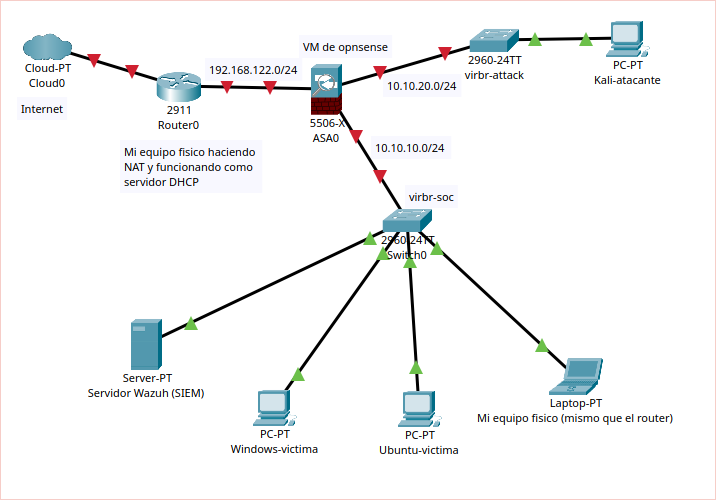

# Laboratorio SOC desde 0

Laboratorio SOC desplegado sobre **KVM** en un único portátil: **Wazuh 4.14** como SIEM, **OPNsense** como cortafuegos entre tres redes aisladas y **Suricata** como IDS de red. Dos víctimas monitorizadas (Windows 10 con Sysmon y Ubuntu Server) y una máquina atacante (Kali) en una red separada, de modo que todo el tráfico del atacante atraviesa el cortafuegos.

📄 **Informe completo (PDF):** en la sección [Releases](../../releases/latest) · fuente LaTeX en [`informe/`](informe/)

## Arquitectura



| Red | Subred | Uso |
|---|---|---|
| `default` | 192.168.122.0/24 | WAN de OPNsense (NAT del host) |
| `soc-lab` | 10.10.10.0/24 | SIEM y víctimas |
| `attack` | 10.10.20.0/24 | Atacante (Kali) |

| VM | IP | Rol |
|---|---|---|
| opnsense | 10.10.10.1 / 10.10.20.1 | Router, firewall, DHCP, Suricata |
| wazuh | 10.10.10.10 | SIEM (indexer, manager, dashboard) |
| windows10 | 10.10.10.130 | Víctima Windows con Sysmon y agente |
| ubuntu-victima | 10.10.10.20 | Víctima Linux con agente |
| kali | 10.10.20.10 | Atacante |

La red del atacante está separada para que su tráfico pase por OPNsense y Suricata. Suricata va dentro de OPNsense en lugar de Security Onion por falta de RAM en el host. Más detalle en el capítulo 2 del informe.

## Escenarios

## Stack

KVM/libvirt · OPNsense 26.7 · Suricata · Wazuh 4.14 · Sysmon (config. SwiftOnSecurity) · Windows 10 22H2 · Ubuntu Server 26.04 · Kali Linux

## Estructura del repositorio

```
.
├── README.md            ← este resumen
├── informe/             ← write-up completo en LaTeX (main.tex → main.pdf)
│   └── secciones/
├── img/                 ← capturas (compartidas por README e informe)
├── configs/             ← configuraciones para reproducir el laboratorio
└── topologiaSOC.pkt     ← topología en Packet Tracer
```

## Referencias

- [Wazuh documentation](https://documentation.wazuh.com/current/)
- [OPNsense documentation](https://docs.opnsense.org/)
- [Suricata User Guide](https://docs.suricata.io/)
- [SwiftOnSecurity/sysmon-config](https://github.com/SwiftOnSecurity/sysmon-config)
- [MITRE ATT&CK](https://attack.mitre.org/)
- [NIST SP 800-61r2 – Computer Security Incident Handling Guide](https://doi.org/10.6028/NIST.SP.800-61r2)
